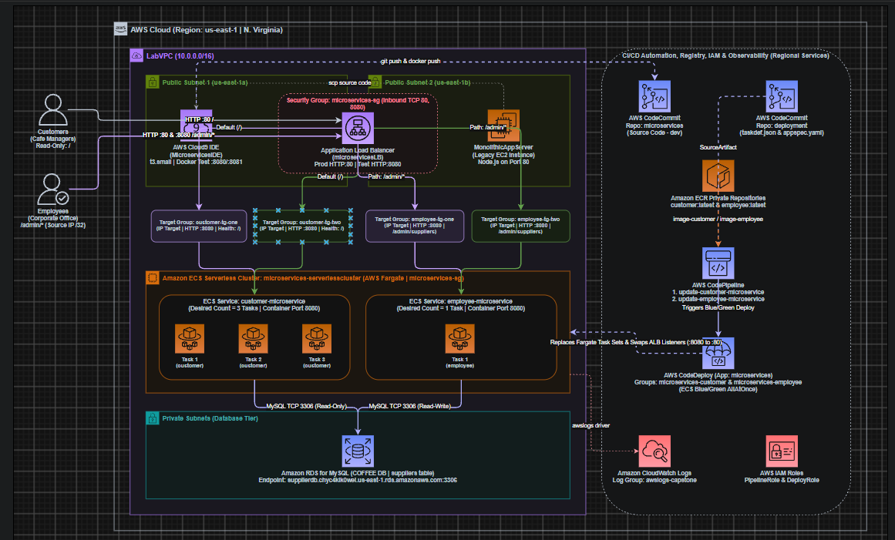
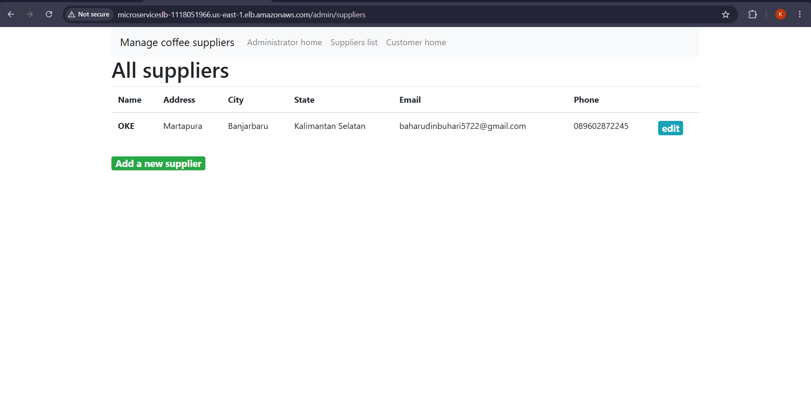
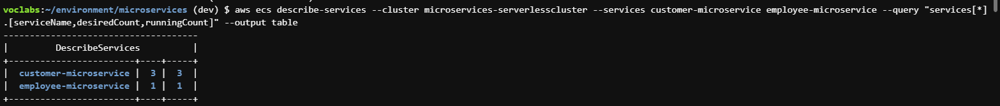
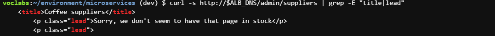

# Cloud-Native Microservices & Automated Blue/Green CI/CD Pipeline on AWS

## 1. Executive Summary & Business Problem
A growing café franchise operated a legacy **monolithic Node.js & Express web application** on a single Amazon EC2 instance (`MonolithicAppServer`) connected to an Amazon RDS MySQL database (`COFFEE`). As the franchise expanded, the monolithic design introduced critical operational bottlenecks:
* **Single Point of Failure & Resource Contention:** Customer read queries and corporate supplier management (CRUD) shared the same Node.js process on TCP port `80`. Spikes in read traffic degraded administrative operations.
* **Lack of Network-Level Access Control:** Administrative routes (`/supplier-add`, `/supplier-update`) were publicly reachable without IP-level filtering at the load balancer layer.
* **Manual, Downtime-Prone Releases:** Code changes required direct SSH access and manual server restarts, interrupting active user sessions.

**Architectural Solution:**  
This project decomposes the monolith into two independently scalable, containerized microservices (**`customer-microservice`** and **`employee-microservice`**) running serverlessly on **Amazon ECS with AWS Fargate**, fronted by an **Application Load Balancer (ALB)** with path-based and source-IP security rules, and backed by an automated **Zero-Downtime Blue/Green CI/CD Pipeline** using **AWS CodeCommit, Amazon ECR, AWS CodePipeline, and AWS CodeDeploy**.

---

## 2. System Architecture & Network Topology

### Interactive Architecture & Traffic Flow
~~~mermaid
flowchart TB
    subgraph Clients["External Clients"]
        Cust["Franchise Managers (Customers) HTTP :80 / (Read-Only)"]
        Emp["Corporate Admins (Employees) HTTP :80 & :8080 /admin/* (Restricted to Authorized IP /32)"]
    end

    subgraph AWS["AWS Cloud Region: us-east-1"]
        subgraph VPC["LabVPC (10.0.0.0/16)"]
            subgraph Pub["Public Subnets 1 & 2 (Multi-AZ)"]
                C9["AWS Cloud9 IDE Docker Build & CLI Management"]
                ALB["Application Load Balancer (microservicesLB) Prod Listener :80 | Test Listener :8080 Security Group: microservices-sg"]
                
                TG_C["Customer Target Groups customer-tg-one (Blue) & customer-tg-two (Green) HTTP :8080 | Health Check: /"]
                TG_E["Employee Target Groups employee-tg-one (Blue) & employee-tg-two (Green) HTTP :8080 | Health Check: /admin/suppliers"]

                subgraph ECS["ECS Cluster: microservices-serverlesscluster (AWS Fargate)"]
                    SvcC["ECS Service: customer-microservice 3 Running Fargate Tasks (0.5 vCPU, 1GB RAM)"]
                    SvcE["ECS Service: employee-microservice 1 Running Fargate Task (0.5 vCPU, 1GB RAM)"]
                end
            end

            subgraph Priv["Private Subnets (Isolated Database Tier)"]
                RDS[("Amazon RDS for MySQL (supplierdb) Engine: MySQL | DB: COFFEE Port: 3306")]
            end
        end

        subgraph CICD["Automated CI/CD & Observability Plane"]
            CC1["AWS CodeCommit: microservices (App Source & Dockerfiles)"]
            CC2["AWS CodeCommit: deployment (taskdef.json & appspec.yaml)"]
            ECR["Amazon ECR Private Registry customer:latest & employee:latest"]
            CP["AWS CodePipeline update-customer-microservice update-employee-microservice"]
            CD["AWS CodeDeploy Blue/Green ECSAllAtOnce"]
            CW["Amazon CloudWatch Logs Log Group: awslogs-capstone"]
        end
    end

    Cust -->|"GET /, /suppliers"| ALB
    Emp -->|"CRUD /admin/*"| ALB

    ALB -->|"Default Action"| TG_C
    ALB -->|"Rule Priority 1: /admin/* + Source IP /32"| TG_E

    TG_C --> SvcC
    TG_E --> SvcE

    SvcC -->|"Read Queries (3306)"| RDS
    SvcE -->|"Read/Write CRUD (3306)"| RDS

    C9 -.->|"git push"| CC1 & CC2
    C9 -.->|"docker push"| ECR
    CC2 & ECR -->|"Source Artifacts"| CP
    CP -->|"Triggers Deployment"| CD
    CD -.->|"Blue/Green Traffic Shift"| ALB & ECS
    SvcC & SvcE -.->|"awslogs Stream"| CW
~~~

---

## 3. Monolithic vs. Refactored Microservices Comparison

| Architectural Dimension | Legacy Monolithic Architecture | Refactored Cloud-Native Microservices |
|---|---|---|
| **Compute Layer** | Single EC2 instance (`MonolithicAppServer`) running Node.js as `root` on port `80`. | Serverless **AWS Fargate** containers orchestrated by **Amazon ECS** (`microservices-serverlesscluster`). |
| **Application Codebase** | Tightly coupled routes in a single Express app (`index.js`). | Split into two isolated services: **`customer`** (Read-Only) and **`employee`** (Full CRUD under `/admin/*`). |
| **Containerization** | None (host-installed Node.js & npm packages). | Lightweight **`node:11-alpine`** Docker images listening on container port `8080`. |
| **Traffic Management** | Direct public IP access to EC2 instance. | **Application Load Balancer (`microservicesLB`)** with path-based routing and dual listeners (`:80` Prod, `:8080` Test). |
| **Security & Access Control** | Admin routes exposed to the public internet (`0.0.0.0/0`). | Admin `/admin/*` routes locked down at the ALB Listener level using **Source IP (`/32`)** conditions. |
| **Horizontal Scaling** | Vertical scaling only (requires EC2 stop/start). | Independent task scaling: **`customer-microservice` scaled to 3 tasks**, while **`employee-microservice` runs 1 task**. |
| **Deployment Strategy** | Manual file copy and process restart (causes downtime). | Automated **Blue/Green Deployment** via **AWS CodePipeline** and **AWS CodeDeploy** with 5-minute bake time. |

---

## 4. Microservices Decomposition & Routing Design

### Service Specifications
| Microservice | Target Audience | HTTP Endpoints | ALB Listener Rule | Health Check Path | Fargate Resource Allocation |
|---|---|---|---|---|---|
| **`customer-microservice`** | Café Franchise Managers | `GET /` `GET /suppliers` `GET /supplier/:id` | **Default Action** (catches all non-admin requests) | `/` | `0.5 vCPU` (`512` CPU units) `1 GB RAM` (`1024` MiB) **Desired Count: 3 Tasks** |
| **`employee-microservice`** | Corporate Office Staff | `GET /admin` `GET /admin/suppliers` `GET/POST /admin/supplier-add` `GET/POST /admin/supplier-update/:id` `POST /admin/supplier-remove/:id` | **Priority 1:** `Path is /admin/*` **AND** `Source IP is <Admin-IP>/32` | `/admin/suppliers` | `0.5 vCPU` (`512` CPU units) `1 GB RAM` (`1024` MiB) **Desired Count: 1 Task** |

### Container Image Specification (`Dockerfile`)
Both microservices are packaged using an identical, minimal Alpine Linux Node.js runtime:
~~~dockerfile
FROM node:11-alpine
RUN mkdir -p /usr/src/app
WORKDIR /usr/src/app
COPY . .
RUN npm install
EXPOSE 8080
CMD ["npm", "run", "start"]
~~~

---

## 5. End-to-End Blue/Green CI/CD Pipeline Mechanics

Each microservice is governed by its own dedicated pipeline (**`update-customer-microservice`** and **`update-employee-microservice`**) to ensure changes to the admin portal never impact customer traffic:

1. **Multi-Source Stage (`AWS CodeCommit` + `Amazon ECR`):**
   * **Source Action 1 (`CodeCommit`):** Monitors the `dev` branch of the `deployment` repository for updates to `taskdef-<service>.json` and `appspec-<service>.yaml`, outputting `SourceArtifact`.
   * **Source Action 2 (`Amazon ECR`):** Monitors the `customer` or `employee` ECR repository for newly pushed `:latest` container images, outputting `image-customer` or `image-employee` (`imageDetail.json`).
2. **Dynamic Image URI Injection:**
   * During the Deploy stage, CodePipeline dynamically replaces the `<IMAGE1_NAME>` placeholder inside `taskdef-<service>.json` with the exact ECR image URI and SHA256 digest from the `image-*` artifact, registering a new ECS Task Definition revision automatically.
3. **Zero-Downtime Blue/Green Traffic Shift (`AWS CodeDeploy`):**
   * **Step 1 (Provision Replacement Task Set):** CodeDeploy launches the new **Green** Fargate tasks alongside the existing **Blue** tasks.
   * **Step 2 (Test Traffic Routing on `:8080`):** The standby Target Group (`*-tg-two` or `*-tg-one`) is attached to the **Test Listener (`HTTP:8080`)** and verified via ALB health checks.
   * **Step 3 (Production Cutover on `:80`):** Once 100% of replacement tasks report `healthy`, CodeDeploy atomically swaps the **Production Listener (`HTTP:80`)** to forward live traffic to the new Target Group (`CodeDeployDefault.ECSAllAtOnce`).
   * **Step 4 (Bake Time & Termination):** The original **Blue** task set remains on standby for **5 minutes** to allow instant rollback before being automatically drained and terminated.

---

## 6. Verification & Testing Results

### A. Microservices UI Isolation & Rolling UI Update
* **Customer Microservice (`/`):** Serves a read-only supplier directory with the dark navigation bar (`navbar-dark bg-dark`) and no administrative controls.
* **Employee Microservice (`/admin/suppliers`):** Serves full CRUD functionality with an updated light navigation bar (`navbar-light bg-light`) rolled out zero-downtime via ECR and CodePipeline.

| Customer Read-Only View (`/suppliers`) | Employee Admin CRUD View (`/admin/suppliers`) |
|---|---|
|  |  |

### B. Automated Blue/Green CI/CD Pipeline Execution
Both `update-customer-microservice` and `update-employee-microservice` pipelines completed `Source` and `Deploy` stages with status **`Succeeded`**:

### C. Independent Horizontal Scaling on AWS Fargate
To accommodate high read volume without over-provisioning admin resources, `customer-microservice` was scaled to **`3` active Fargate tasks** (`desiredCount: 3`, `runningCount: 3`), while `employee-microservice` remained at **`1` task**:

### D. Network-Level Admin Access Control (ALB Source IP Restriction)
ALB listener rules on ports `80` and `8080` restrict `/admin/*` traffic exclusively to the administrator's public IPv4 address (`/32`). Unauthorized requests (tested via `curl` from the Cloud9 EC2 instance IP) bypass the `employee` target group and fall through to the `customer` microservice's `404 Not Found` handler (`Sorry, we don't seem to have that page in stock`):

---

## 7. Engineering Troubleshooting & Lessons Learned

During the refactoring and CI/CD implementation, several real-world engineering challenges were diagnosed and resolved:

1. **Container Crash Loop (`Error: Cannot find module 'mysql'`):**
   * **Root Cause:** The refactored `customer` model imported `require("mysql")`, whereas `package.json` bundled the `mysql2` driver.
   * **Resolution:** Inspected container crash logs via `docker logs customer_1`, patched `supplier.model.js` to import `mysql2`, rebuilt the Docker image, and pushed the verified image to Amazon ECR.
2. **CodeDeploy Blue/Green Target Group Mismatch (`InvalidTargetGroupPairException`):**
   * **Root Cause:** After modifying ALB listener rules to add Source-IP restrictions on ports `80` and `8080`, the production and test listeners pointed to the inverse Target Group pair expected by the active ECS task set.
   * **Resolution:** Queried the active target group ARN directly from `aws ecs describe-services` and synchronized the `HTTP:80` (Production) and `HTTP:8080` (Test) listener rules via `aws elbv2 modify-listener` and `modify-rule` prior to triggering CodePipeline.
3. **Database Connection Handling Across Lab Restarts:**
   * **Root Cause:** Fargate tasks launching before the Amazon RDS instance reached the `available` state exited prematurely.
   * **Resolution:** Automated RDS state verification (`describe-db-instances`) and re-triggered ECS service deployments once the database endpoint was ready.

---

## 8. Repository Structure

~~~text
aws-microservices-cicd-capstone/
├── customer/                          # Read-Only Customer Microservice (Node.js + Express)
│   ├── app/
│   │   ├── config/config.js           # Environment-variable driven DB connection config
│   │   ├── controller/                # Read-only Express controllers (findAll, findOne)
│   │   └── models/                    # MySQL2 query models
│   ├── public/                        # Static assets (Bootstrap CSS/JS)
│   ├── views/                         # Mustache HTML templates (read-only views)
│   ├── Dockerfile                     # Alpine Node.js container specification (Port 8080)
│   ├── index.js                       # Express application entry point
│   └── package.json
├── employee/                          # Read-Write Employee Admin Microservice (/admin/*)
│   ├── app/                           # Full CRUD controllers & models
│   ├── public/
│   ├── views/                         # Admin Mustache templates (navbar-light UI)
│   ├── Dockerfile                     # Alpine Node.js container specification (Port 8080)
│   ├── index.js                       # Express entry point with /admin route prefixing
│   └── package.json
├── deployment/                        # CI/CD & ECS Fargate Deployment Manifests
│   ├── appspec-customer.yaml          # CodeDeploy Blue/Green AppSpec (customer)
│   ├── appspec-employee.yaml          # CodeDeploy Blue/Green AppSpec (employee)
│   ├── taskdef-customer.json          # ECS Fargate Task Definition (customer)
│   └── taskdef-employee.json          # ECS Fargate Task Definition (employee)
└── docs/
    └── screenshots/                   # Architecture & verification evidence images
~~~

---

## 9. 12-Month AWS Cost Estimation (`us-east-1`)

| AWS Service | Configuration Summary | Monthly (USD) | 12-Month Total (USD) |
|---|---|---:|---:|
| **Amazon ECS on AWS Fargate** | 4 Tasks (`3 customer` + `1 employee`), `0.5 vCPU`, `1 GB RAM`, 730 hrs/mo | $72.08 | $864.96 |
| **Elastic Load Balancing (ALB)** | 1 Internet-facing ALB (`microservicesLB`) + ~1 LCU | $22.27 | $267.24 |
| **Amazon EC2 + EBS (Cloud9 IDE)** | 1x `t3.small` Linux On-Demand + `10 GB` gp3 EBS | $15.98 | $191.76 |
| **Amazon RDS for MySQL** | 1x `db.t3.micro` Single-AZ + `20 GB` gp2 SSD (`COFFEE` DB) | $14.71 | $176.52 |
| **AWS CodePipeline** | 2 Active V1 Pipelines (`customer` & `employee`) | $2.00 | $24.00 |
| **Amazon ECR** | `1 GB` Private Repository Storage | $0.10 | $1.20 |
| **VPC, CodeCommit, CodeDeploy, IAM, CloudWatch** | Covered under AWS Free Tier / $0.00 additional charge | $0.00 | $0.00 |
| **Total Estimated Cost** | **Full 11-Service Architecture** | **$127.14** | **$1,525.68** |

---

## Author
**Baharudin Buhari** ([@rudzkk755](https://github.com/rudzkk755))  
*Cloud Computing, DevOps & Network Engineering Enthusiast*
