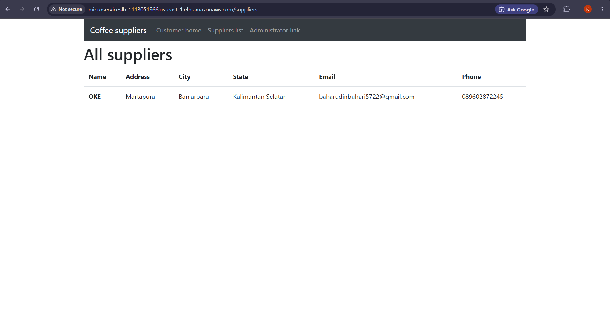
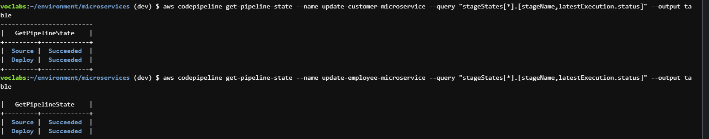

# Cloud-Native Microservices & Automated Blue/Green CI/CD Pipeline on AWS

## Project Overview
This project refactors a legacy **monolithic Node.js & MySQL web application** running on a single EC2 instance into a **highly available, scalable, cloud-native microservices architecture** deployed on **Amazon ECS with AWS Fargate**.

The monolithic application is split into two isolated containerized microservices (`customer-microservice` and `employee-microservice`) behind an **Application Load Balancer (ALB)** with path-based and source-IP routing rules, backed by a fully automated **Blue/Green CI/CD pipeline** using **AWS CodeCommit, Amazon ECR, AWS CodePipeline, and AWS CodeDeploy**.

---

## 1. System Architecture

---

## 2. Microservices Routing & Specifications

| Microservice | Target Audience | Access Level | ALB Routing Rule | Health Check | Compute Specs (Fargate) |
|---|---|---|---|---|---|
| **`customer-microservice`** | Café Franchise Managers | **Read-Only** (`GET /`, `GET /suppliers`) | Default (`/*`) | `/` | `0.5 vCPU`, `1 GB RAM`, **3 Tasks** |
| **`employee-microservice`** | Corporate Office Admins | **Read-Write** (`CRUD /admin/suppliers`) | `Path is /admin/*` **AND** `Source IP is <Admin-IP>/32` | `/admin/suppliers` | `0.5 vCPU`, `1 GB RAM`, **1 Task** |

---

## 3. Verification & Testing Results

### A. Microservices UI Isolation & Rolling UI Update
* **Customer Microservice (`/`):** Serves a read-only supplier directory with the dark navigation bar (`navbar-dark`) and no edit/delete controls.
* **Employee Microservice (`/admin/suppliers`):** Serves full CRUD functionality with an updated light navigation bar (`navbar-light`) deployed zero-downtime via **Amazon ECR** and **AWS CodePipeline**.

| Customer Read-Only View (`/suppliers`) | Employee Admin CRUD View (`/admin/suppliers`) |
|---|---|
|  |  |

### B. Automated Blue/Green CI/CD Pipeline Execution
Both `update-customer-microservice` and `update-employee-microservice` pipelines automatically pull task definitions/AppSpec files from **AWS CodeCommit** and container images from **Amazon ECR**, executing a **Blue/Green replacement** via **AWS CodeDeploy**:

### C. Independent Horizontal Scaling on AWS Fargate
To handle higher read traffic from café franchise managers without over-provisioning admin compute, `customer-microservice` was independently scaled from `1` to **`3` running Fargate tasks**, while `employee-microservice` remained at **`1` task**:

### D. Network-Level Admin Access Control (ALB Source IP Restriction)
The Application Load Balancer listener rules for `/admin/*` were hardened with a `Source IP (/32)` condition. Requests originating from unauthorized IP addresses (tested via `curl` from the Cloud9 instance) bypass the admin target group and return a `404 Not Found` response from the default customer service:

---

## 4. 12-Month AWS Cost Estimation (`us-east-1`)

| AWS Service | Configuration Summary | Monthly (USD) | 12-Month Total (USD) |
|---|---|---:|---:|
| **Amazon ECS on AWS Fargate** | 4 Tasks (`3 customer` + `1 employee`), `0.5 vCPU`, `1 GB RAM`, 730 hrs/mo | $72.08 | $864.96 |
| **Elastic Load Balancing (ALB)** | 1 Internet-facing ALB (`microservicesLB`) + ~1 LCU | $22.27 | $267.24 |
| **Amazon EC2 + EBS (Cloud9 IDE)** | 1x `t3.small` Linux On-Demand + `10 GB` gp3 EBS | $15.98 | $191.76 |
| **Amazon RDS for MySQL** | 1x `db.t3.micro` Single-AZ + `20 GB` gp2 SSD (`COFFEE` DB) | $14.71 | $176.52 |
| **AWS CodePipeline** | 2 Active V1 Pipelines (`customer` & `employee`) | $2.00 | $24.00 |
| **Amazon ECR** | `1 GB` Private Repository Storage | $0.10 | $1.20 |
| **VPC, CodeCommit, CodeDeploy, IAM, CloudWatch** | Covered under AWS Free Tier / $0.00 additional charge | $0.00 | $0.00 |
| **Total Estimated Cost** | **Full 11-Service Architecture** | **$127.14** | **$1,525.68** |

---

## Author
**Baharudin Buhari** ([@rudzkk755](https://github.com/rudzkk755))
